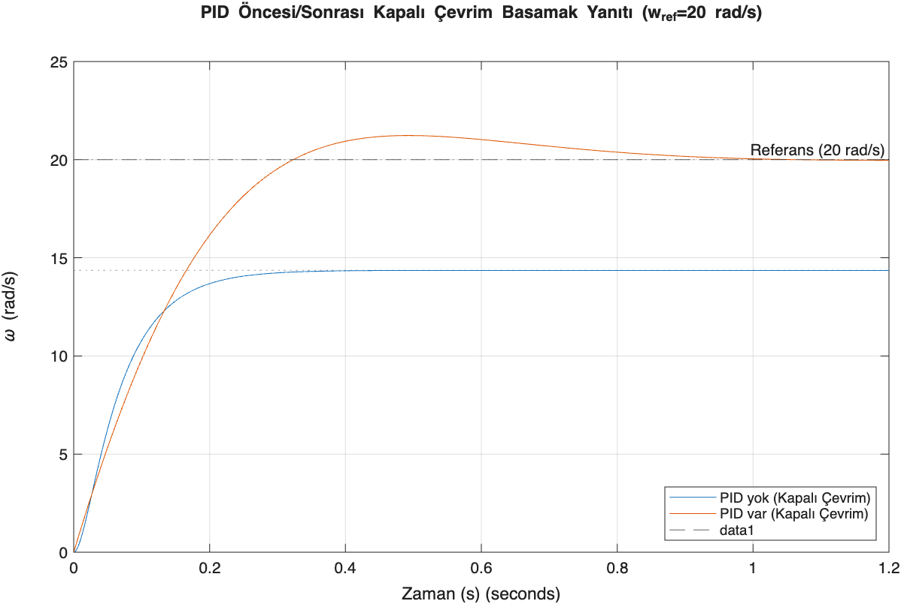
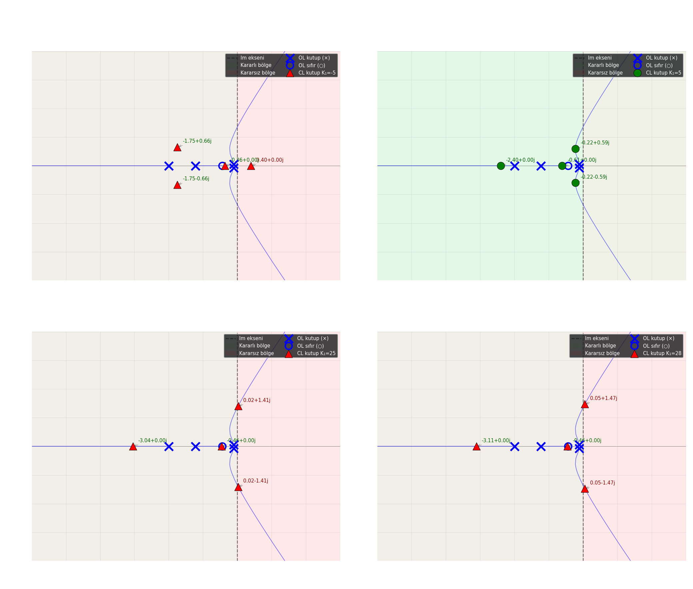
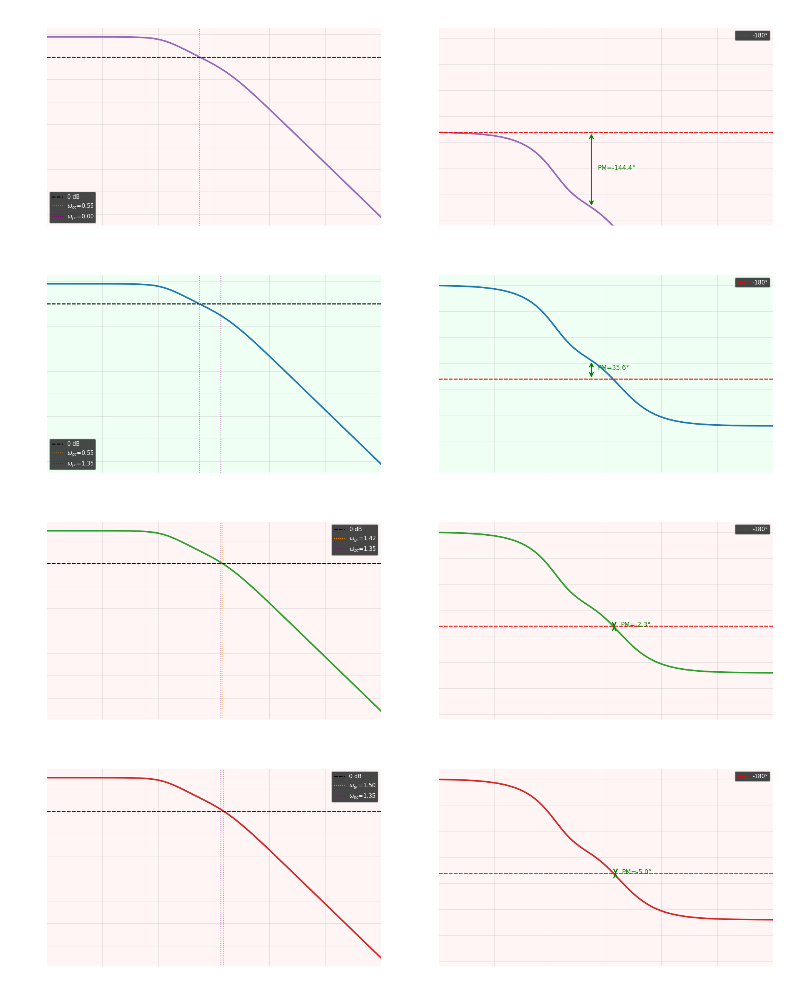

# 🎛️ Control Systems Labs

**DC motor modelling and PID design in MATLAB / Simulink, and stability analysis (Bode, Nyquist, root locus) in Python.**
KTÜ EEE — System Dynamics & Control · Control and Drive Systems Lab II

> **RU:** Модель DC‑двигателя: передаточная функция, полюса, пространство состояний, канонические формы, управляемость/наблюдаемость, временной отклик и PID. Плюс лаба по устойчивости.
> **TR:** DC motor modeli: transfer fonksiyonu, kutuplar, durum uzayı, kanonik formlar, kontrol edilebilirlik/gözlemlenebilirlik, zaman cevabı ve PID. Artı kararlılık laboratuvarı.

## 1 · DC motor project ([`dc_motor_project/`](dc_motor_project))

Plant "DC‑4" (R = 5 Ω, L = 0.06 H, J = 0.0016 kg·m²):

$$
G(s)=\frac{0.08}{9.6\cdot10^{-5}\,s^2+0.0083\,s+0.0314}
$$

Poles at $s\approx-3.96$ and $s\approx-82.5$ rad/s (overdamped, $\zeta\approx2.4$), DC gain ≈ 2.55.

| Step | MATLAB | Simulink |
|---|---|---|
| transfer function, poles / zeros, pzmap | `Transfer_Fn_analizi.m` | `simu_fnc.slx` |
| time response (step info, final value) | `Zaman_cvbi_analizi.m` | `model3.slx`, `mod31.slx` |
| state space | `durum_uzayi.m` | |
| controllable / observable canonical forms | `Kanonikler.m` | `kanonik.slx` |
| controllability & observability rank | `rank_analizi.m` | |
| PID tuning, settling time | `Pid_denet_tsr.m` | `sis_pid.slx` |

Figures in `figures/`, full report (Turkish) in `report/`.

## 2 · Stability lab D3 ([`d3_stability_lab/`](d3_stability_lab))

Python notebook: Bode, Nyquist, root locus and a stability map, with the plots saved as PNG.

 

The same control ideas run the cascade current‑PI + gap‑PID of my EMS levitation project — see my [profile](https://github.com/Bugee03).
